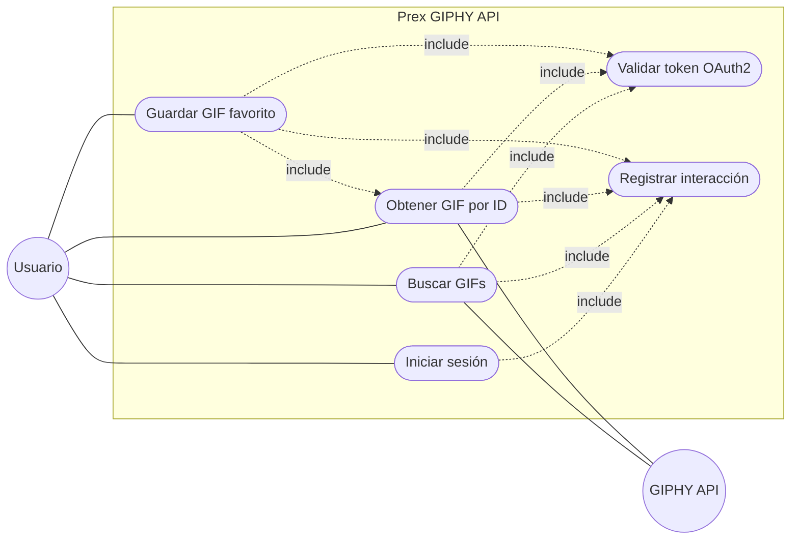
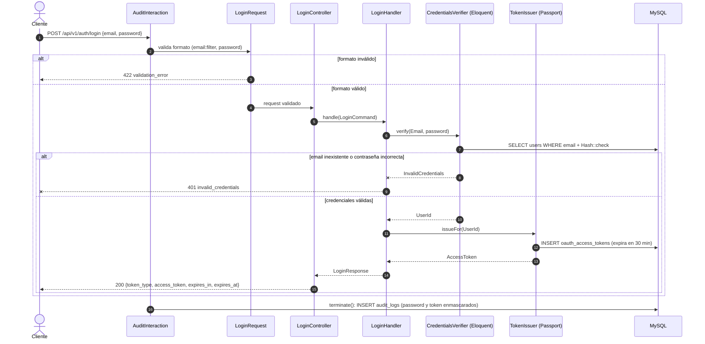
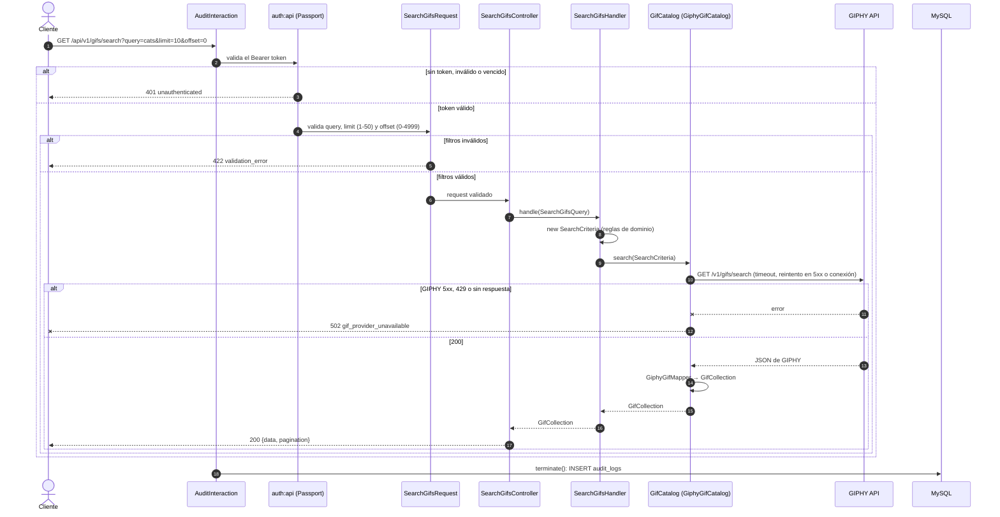
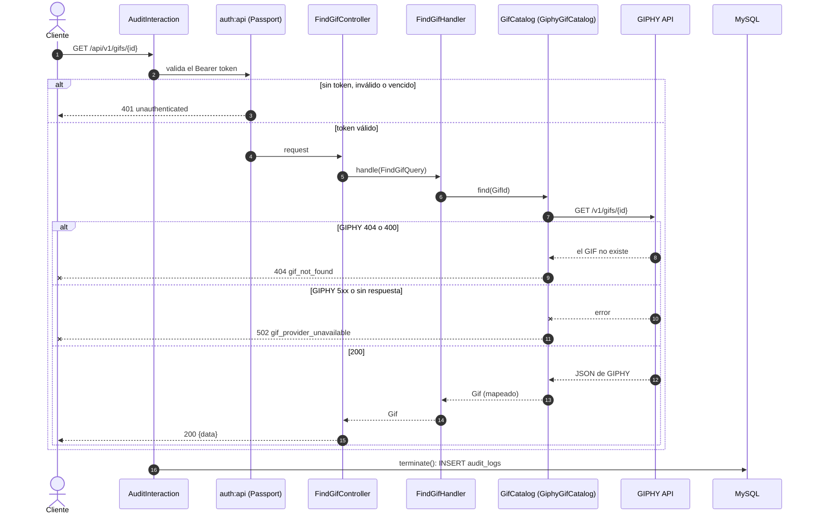
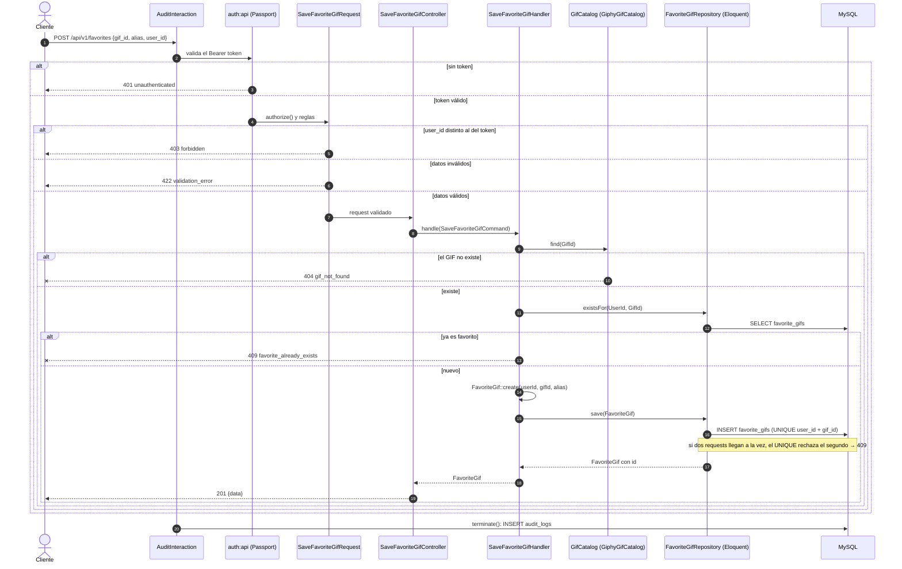
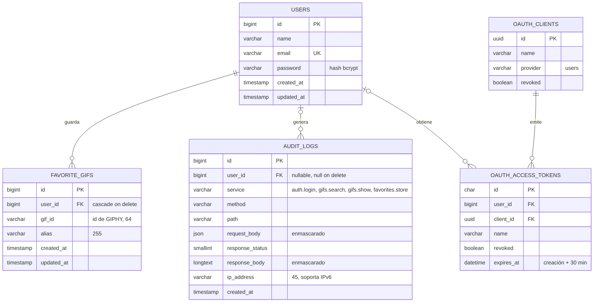

# Prex GIPHY API

API REST en Laravel que se integra con la API de [GIPHY](https://developers.giphy.com/docs/api/) para buscar GIFs, consultar un GIF por ID y guardar GIFs favoritos por usuario. Autenticación OAuth2.0 y registro de todas las interacciones.

Construida con **arquitectura hexagonal + DDD**.

## Índice

- [Stack](#stack) · [Requisitos](#requisitos) · [Levantar el proyecto](#levantar-el-proyecto) · [Comandos útiles](#comandos-útiles)
- Servicios: [Autenticación](#autenticación) · [GIFs](#gifs) · [Favoritos](#favoritos) · [Auditoría](#auditoría)
- [Colección Postman](#colección-postman) · [Tests](#tests) · [Estructura del proyecto](#estructura-del-proyecto) · [Arquitectura](#arquitectura)
- [Diagramas](#diagramas): casos de uso, secuencias y DER
- [Supuestos](#supuestos) · [Decisiones de diseño](#decisiones-de-diseño) · [Mejoras futuras](#mejoras-futuras)

## Stack

| Componente | Versión |
|---|---|
| PHP | 8.4 |
| Laravel | 13 |
| MySQL | 8.0 |
| Tests | Pest 5 (PHPUnit 13) |
| Servidor web | Nginx + PHP-FPM |
| Contenedores | Docker Compose |

## Requisitos

- Docker (Docker Desktop, OrbStack o Docker Engine con el plugin Compose)
- Git
- Una API key de GIPHY: se crea gratis en [developers.giphy.com](https://developers.giphy.com/dashboard/) → *Create an API Key* → tipo **API**.

No hace falta tener PHP, Composer ni MySQL instalados: todo corre dentro de Docker.

La key de GIPHY solo se usa para llamar a la API real (curl o Postman). **Los tests no la necesitan**: GIPHY se simula con `Http::fake()` y fixtures, así que `make test` funciona aunque `GIPHY_API_KEY` esté vacía. Sin key, la app levanta igual y el login funciona; buscar y guardar favoritos responden 502 `gif_provider_unavailable`.

## Levantar el proyecto

```bash
git clone <url-del-repo> prex-giphy-challenge
cd prex-giphy-challenge

cp .env.example .env
# Editar .env y completar GIPHY_API_KEY

docker compose up -d --build
```

La primera vez tarda unos minutos. En cada arranque, el contenedor hace todo solo: instala dependencias si faltan, genera la `APP_KEY`, corre las migraciones, genera las claves de Passport (si no existen) y crea el usuario de prueba y el cliente de OAuth (sin duplicarlos).

Para verificar que levantó:

```bash
docker compose ps                 # app, nginx y mysql corriendo; mysql (healthy)
curl http://localhost:8080        # {"name":"Prex GIPHY API","status":"ok"}
curl -i http://localhost:8080/up  # HTTP/1.1 200 OK
```

### Servicios

| Servicio | Qué es | Puerto en tu máquina |
|---|---|---|
| `nginx` | Servidor web, entrada de la API | `8080` |
| `app` | PHP-FPM 8.4 con Laravel | — (interno, 9000) |
| `mysql` | Base de datos MySQL 8.0 | `3307` |

Bases de datos: `prex` (aplicación) y `prex_testing` (tests). Usuario `prex`, contraseña `secret` (solo para desarrollo).

### Linux y Windows

- **Linux:** el contenedor corre con un usuario no-root con UID/GID 1000. Si tu usuario tiene otro UID (`id -u`), construí la imagen con el tuyo para evitar errores de permisos en `storage/` y `vendor/`:
  ```bash
  HOST_UID=$(id -u) HOST_GID=$(id -g) docker compose up -d --build
  ```
- **Windows:** usar Docker Desktop con WSL 2. Si clonás el repo dentro del sistema de archivos de WSL, aplica lo mismo que en Linux.

## Comandos útiles

Atajos del `Makefile` (requieren `make`; al lado, el comando equivalente):

| Comando | Equivale a | Para qué |
|---|---|---|
| `make up` | `docker compose up -d` | Levantar |
| `make down` | `docker compose down` | Apagar |
| `make build` | `docker compose build` | Reconstruir la imagen |
| `make logs` | `docker compose logs -f` | Ver logs |
| `make shell` | `docker compose exec app sh` | Entrar al contenedor |
| `make migrate` | `docker compose exec app php artisan migrate` | Correr migraciones |
| `make test` | `docker compose exec app php artisan test` | Correr los tests |
| `make coverage` | `docker compose exec app php artisan test --coverage` | Tests con cobertura |

Para empezar con la base vacía: `docker compose down -v` (borra el volumen de MySQL).

## Autenticación

La API usa OAuth2 con **Laravel Passport** (Personal Access Tokens). Al levantar el contenedor se generan las claves de Passport (si no existen) y se cargan, sin duplicar, el usuario de prueba y el cliente de tokens personales.

Usuario de prueba:

| Email | Contraseña |
|---|---|
| `test@prex.com` | `password` |

### Login

`POST /api/v1/auth/login` (no requiere autenticación)

```bash
curl -X POST http://localhost:8080/api/v1/auth/login \
  -H 'Accept: application/json' \
  -H 'Content-Type: application/json' \
  -d '{"email": "test@prex.com", "password": "password"}'
```

**200 OK**: credenciales válidas.

```json
{
  "token_type": "Bearer",
  "access_token": "eyJ0eXAiOiJKV1QiLCJhbGciOiJSUzI1NiJ9...",
  "expires_in": 1800,
  "expires_at": "2026-10-23T10:51:05+00:00"
}
```

**401 Unauthorized**: email inexistente o contraseña incorrecta (mismo mensaje en ambos casos, para no revelar qué emails están registrados).

```json
{"error": {"code": "invalid_credentials", "message": "Invalid email or password."}}
```

**422 Unprocessable Entity**: datos faltantes o con formato inválido.

```json
{
  "error": {
    "code": "validation_error",
    "message": "The given data is invalid.",
    "details": {
      "email": ["The email field must be a valid email address."],
      "password": ["The password field is required."]
    }
  }
}
```

El token **dura 30 minutos** (`expires_in` en segundos, `expires_at` en ISO 8601). Se envía en el header `Authorization: Bearer <access_token>` en los endpoints protegidos.

## GIFs

Búsqueda y detalle de GIFs a través de la API de GIPHY. Los dos endpoints **requieren token** (`Authorization: Bearer <access_token>`).

La API no reenvía el JSON de GIPHY: lo traduce a un formato propio, igual en la búsqueda y en el detalle.

| Campo | Qué es |
|---|---|
| `id` | ID del GIF en GIPHY (alfanumérico) |
| `title` | Título (puede venir vacío) |
| `url` | Página del GIF en giphy.com |
| `embed_url` | URL para embeber en un `iframe` |
| `rating` | Clasificación por edad (`g`, `pg`, `pg-13`, `r`) |
| `username` | Usuario que lo subió (string vacío si no tiene) |
| `images.original` | Imagen original: `url`, `width`, `height` (en píxeles) |
| `images.preview` | Versión liviana de 200 px de ancho: `url`, `width`, `height` |

### Buscar GIFs

`GET /api/v1/gifs/search`

| Parámetro | Obligatorio | Valores | Default |
|---|---|---|---|
| `query` | Sí | Texto de 1 a 50 caracteres | — |
| `limit` | No | Entero de 1 a 50 | 25 |
| `offset` | No | Entero de 0 a 4999 | 0 |

```bash
curl -G http://localhost:8080/api/v1/gifs/search \
  -H 'Accept: application/json' \
  -H "Authorization: Bearer $TOKEN" \
  --data-urlencode 'query=cat' -d limit=2 -d offset=0
```

**200 OK**: `pagination.total` es el total de resultados que informa GIPHY, `count` cuántos vinieron en esta página y `offset` desde dónde arranca.

```json
{
  "data": [
    {
      "id": "774uK11mxE3W0cjE8L",
      "title": "High Five Ai GIF",
      "url": "https://giphy.com/gifs/ai-cat-meme-774uK11mxE3W0cjE8L",
      "embed_url": "https://giphy.com/embed/774uK11mxE3W0cjE8L",
      "rating": "g",
      "username": "enayatperak",
      "images": {
        "original": {"url": "https://media4.giphy.com/media/774uK11mxE3W0cjE8L/giphy.gif", "width": 480, "height": 480},
        "preview": {"url": "https://media4.giphy.com/media/774uK11mxE3W0cjE8L/200w.gif", "width": 200, "height": 200}
      }
    }
  ],
  "pagination": {"total": 500, "count": 1, "offset": 0}
}
```

Si no hay resultados, responde **200** con `"data": []`.

### Obtener un GIF por ID

`GET /api/v1/gifs/{id}`

```bash
curl http://localhost:8080/api/v1/gifs/774uK11mxE3W0cjE8L \
  -H 'Accept: application/json' \
  -H "Authorization: Bearer $TOKEN"
```

**200 OK**:

```json
{
  "data": {
    "id": "774uK11mxE3W0cjE8L",
    "title": "High Five Ai GIF",
    "url": "https://giphy.com/gifs/ai-cat-meme-774uK11mxE3W0cjE8L",
    "embed_url": "https://giphy.com/embed/774uK11mxE3W0cjE8L",
    "rating": "g",
    "username": "enayatperak",
    "images": {
      "original": {"url": "https://media4.giphy.com/media/774uK11mxE3W0cjE8L/giphy.gif", "width": 480, "height": 480},
      "preview": {"url": "https://media4.giphy.com/media/774uK11mxE3W0cjE8L/200w.gif", "width": 200, "height": 200}
    }
  }
}
```

### Errores

Todos los errores usan el formato `{"error": {"code": "...", "message": "..."}}`.

| HTTP | `code` | Cuándo |
|---|---|---|
| 401 | `unauthenticated` | Falta el token, es inválido o expiró |
| 404 | `gif_not_found` | GIPHY no tiene un GIF con ese ID |
| 404 | `not_found` | La ruta no existe, o el `{id}` tiene caracteres que no son letras ni números (la ruta no matchea) |
| 422 | `validation_error` | Parámetros de búsqueda inválidos (detalle por campo en `error.details`) |
| 422 | `invalid_argument` | ID alfanumérico de más de 64 caracteres |
| 502 | `gif_provider_unavailable` | GIPHY no responde, tarda demasiado, devuelve error o limita la cuota (429) |

```json
{"error": {"code": "gif_not_found", "message": "GIF not found."}}
```

```json
{"error": {"code": "not_found", "message": "Resource not found."}}
```

```json
{"error": {"code": "gif_provider_unavailable", "message": "The GIF service is unavailable. Please try again later."}}
```

Las respuestas de error de GIPHY nunca se devuelven al cliente; solo se registran en el log (status y path, sin la API key).

### Integración con GIPHY

- Configuración en `.env`: `GIPHY_API_KEY`, `GIPHY_BASE_URL` (default `https://api.giphy.com/v1`) y `GIPHY_TIMEOUT` (segundos, default 5).
- Timeout de conexión de 3 segundos.
- Hace hasta 2 intentos, con 200 ms entre uno y otro, **solo** ante un error de conexión o una respuesta 5xx de GIPHY. Un 404, un 400 o un 429 no se reintentan.
- En el detalle por ID, GIPHY responde 404 para IDs inexistentes y 400 para IDs con formato que no acepta. Los dos se informan como `gif_not_found`.

## Favoritos

Guarda un GIF como favorito del usuario autenticado. Requiere token (`Authorization: Bearer <access_token>`).

Se persiste solo la referencia al GIF (`gif_id`, más el `alias` que elige el usuario). No se copian título, URLs ni imágenes: eso sigue viviendo en GIPHY.

### Guardar GIF favorito

`POST /api/v1/favorites`

| Campo | Obligatorio | Valores |
|---|---|---|
| `gif_id` | Sí | Alfanumérico, de 1 a 64 caracteres |
| `alias` | Sí | Texto de 1 a 255 caracteres. Los espacios de los extremos se recortan |
| `user_id` | Sí | Entero que exista en `users` y sea el mismo usuario del token |

```bash
curl -X POST http://localhost:8080/api/v1/favorites \
  -H 'Accept: application/json' \
  -H 'Content-Type: application/json' \
  -H "Authorization: Bearer $TOKEN" \
  -d '{"gif_id": "774uK11mxE3W0cjE8L", "alias": "mi gif favorito", "user_id": 1}'
```

**201 Created**:

```json
{
  "data": {
    "id": 1,
    "user_id": 1,
    "gif_id": "774uK11mxE3W0cjE8L",
    "alias": "mi gif favorito",
    "created_at": "2026-10-23T14:17:24+00:00"
  }
}
```

`created_at` va en ISO 8601. `id` lo asigna la base.

Reglas de negocio:

- El GIF tiene que existir en GIPHY. Si no existe, responde 404 `gif_not_found` y no se guarda nada.
- Un usuario no puede tener dos veces el mismo GIF. El segundo intento responde 409 `favorite_already_exists`. El índice `UNIQUE (user_id, gif_id)` también lo impide si dos requests pasan el chequeo al mismo tiempo. Otro alias no lo convierte en un favorito nuevo. Dos usuarios distintos sí pueden guardar el mismo GIF.
- `user_id` tiene que ser el usuario del token. Si es otro, responde 403 y no se guarda nada.

**401 Unauthorized**: falta el token, es inválido o expiró.

```json
{"error": {"code": "unauthenticated", "message": "Missing, invalid or expired token."}}
```

**403 Forbidden**: `user_id` numérico distinto del usuario autenticado. Se evalúa antes de la validación, así que un id como `999` (aunque no exista) responde 403 y no 422.

```json
{"error": {"code": "forbidden", "message": "You cannot save favorites for another user."}}
```

**404 Not Found**: GIPHY no tiene ese GIF. Si GIPHY no responde, el código es el mismo 502 `gif_provider_unavailable` de la sección GIFs.

```json
{"error": {"code": "gif_not_found", "message": "GIF not found."}}
```

**409 Conflict**:

```json
{"error": {"code": "favorite_already_exists", "message": "This GIF is already in your favorites."}}
```

**422 Unprocessable Entity**: falta un campo, `gif_id` tiene símbolos o pasa de 64 caracteres, `alias` pasa de 255, o `user_id` no es un entero. Si `user_id` no viene o no es numérico, también es 422 (no 403).

```json
{
  "error": {
    "code": "validation_error",
    "message": "The given data is invalid.",
    "details": {
      "alias": ["The alias field is required."]
    }
  }
}
```

## Auditoría

Cada llamada a los cuatro servicios queda registrada, también cuando falla (401, 403, 404, 409, 422 y 502). No hay endpoint para consultar ni borrar esos registros.

El middleware escribe la fila **después** de armar la respuesta (`terminate()`). El cliente ya recibió su status. Si el insert falla, el error queda en el log de Laravel y la respuesta de la API no cambia. `/` y `/up` no pasan por ese middleware.

Antes de guardar, estas claves se reemplazan por `***`, sin importar mayúsculas, también adentro de objetos anidados y de un string que sea JSON: `password`, `password_confirmation`, `access_token`, `token`, `api_key`, `authorization`. La clave tiene que coincidir entera: `token_type` se guarda tal cual.

| Columna | Qué guarda |
|---|---|
| `id` | Autoincremental |
| `user_id` | Usuario del token, o el del login exitoso. `NULL` si no hay usuario (credenciales inválidas, request sin token). Si el usuario se borra, la fila queda y `user_id` pasa a `NULL` |
| `service` | Nombre de la ruta: `auth.login`, `gifs.search`, `gifs.show`, `favorites.store` |
| `method` | Verbo HTTP, hasta 10 caracteres |
| `path` | Path del request, por ejemplo `/api/v1/gifs/search` |
| `request_body` | JSON del body y del query string, ya enmascarado |
| `response_status` | Status HTTP, de 100 a 599 |
| `response_body` | Cuerpo de la respuesta, texto largo, ya enmascarado |
| `ip_address` | IP del cliente, hasta 45 caracteres (entra una IPv6). Nginx reenvía `X-Forwarded-For` y Laravel confía en las redes privadas de Docker (`10.0.0.0/8`, `172.16.0.0/12`, `192.168.0.0/16`) |
| `created_at` | Momento del registro. No hay `updated_at`: la fila no se actualiza |

## Colección Postman

En [`postman/`](postman/) están la colección y el environment local:

| Archivo | Qué es |
|---|---|
| `Prex-GIPHY-API.postman_collection.json` | Los 4 servicios y sus casos de error, con descripción de entradas y respuestas y tests en cada request |
| `Prex-GIPHY-Local.postman_environment.json` | Variables: `base_url`, `email`, `password`, `user_id`, `access_token`, `gif_id` |

Uso:

1. Postman → **Import** → los dos archivos.
2. Seleccionar el environment **Prex GIPHY - Local**.
3. Ejecutar **Auth → Login**. Un script guarda el token en `access_token` (y su vencimiento en `token_expires_at`); el resto de la colección lo usa como `Bearer {{access_token}}`.
4. Ejecutar **GIFs → Buscar GIFs**: guarda el primer resultado en `gif_id`, que usan "Obtener GIF por ID" y "Guardar GIF favorito".
5. Para correr todo de una vez: click derecho en la colección → **Run collection**.

El token vence a los 30 minutos: si un request devuelve 401, volver a ejecutar el login.

## Tests

Los tests corren **dentro de Docker** contra la base `prex_testing` (nunca contra la base de la aplicación):

```bash
make test
```

Otras formas de correrlos:

```bash
docker compose exec app php artisan test --testsuite=Arch     # solo arquitectura
docker compose exec app php artisan test --filter="health"    # por nombre
docker compose exec app php artisan test --coverage           # con cobertura (PCOV)
```

Suites:

| Suite | Qué contiene |
|---|---|
| `Arch` | Reglas de arquitectura verificadas automáticamente: el dominio no depende de Laravel, la capa de aplicación no depende de infraestructura, los controllers no acceden a la persistencia, `strict_types` en todo `src/`, sin funciones de debug |
| `Unit` | Lógica de negocio aislada, sin framework ni base de datos (usa fakes en memoria de `tests/Support/Fakes`) |
| `Integration` | Adapters contra la base real (Eloquent, Passport) con `RefreshDatabase`, y el adapter de GIPHY con `Http::fake()` y fixtures en `tests/Fixtures/giphy` |
| `Feature` | Endpoints HTTP de punta a punta (GIPHY siempre simulado: los tests nunca llaman a la API real) |

## Estructura del proyecto

El código propio vive en `src/`, organizado primero por módulo de negocio y después por capa:

```
src/
├── IdentityAccess/   autenticación y tokens
├── Gifs/             búsqueda y detalle de GIFs (integración con GIPHY)
├── Favorites/        GIFs favoritos de cada usuario
├── Audit/            registro de interacciones con la API
└── Shared/           elementos comunes
    └── cada módulo: Domain/ · Application/ · Infrastructure/
```

| Capa | Contiene | Depende de |
|---|---|---|
| `Domain` | Entidades, value objects, puertos (interfaces) y excepciones de negocio. PHP puro | Nada |
| `Application` | Casos de uso | `Domain` |
| `Infrastructure` | Controllers, adapters (Eloquent, GIPHY, Passport), configuración | Todo |

`app/` conserva solo el arranque de Laravel.

## Arquitectura

**Hexagonal + DDD.** Cada módulo tiene su dominio puro, sus casos de uso y sus adapters. Los casos de uso dependen de **puertos** (interfaces del dominio) y la infraestructura los implementa:

| Módulo | Puerto (Domain) | Adapter real (Infrastructure) | Fake en tests |
|---|---|---|---|
| IdentityAccess | `CredentialsVerifier` | `EloquentCredentialsVerifier` | `InMemoryCredentialsVerifier` |
| IdentityAccess | `TokenIssuer` | `PassportTokenIssuer` | `FakeTokenIssuer` |
| Gifs | `GifCatalog` | `GiphyGifCatalog` (+ `GiphyGifMapper`) | `FakeGifCatalog` |
| Favorites | `FavoriteGifRepository` | `EloquentFavoriteGifRepository` | `InMemoryFavoriteGifRepository` |
| Audit | `AuditLogRepository` | `EloquentAuditLogRepository` | `InMemoryAuditLogRepository` |
| Shared | `Clock` | `SystemClock` | `FixedClock` |

Flujo de una request:

```
HTTP → AuditInteraction (middleware) → auth:api (Passport) → FormRequest (formato)
     → Controller → Handler (caso de uso) → Puertos → Adapters (MySQL / GIPHY / Passport)
     → JSON
     ↳ cualquier excepción → DomainExceptionRenderer → {"error": {"code", "message"}}
     ↳ después de responder: AuditInteraction::terminate() → INSERT audit_logs
```

- Los bindings puerto → adapter están en un ServiceProvider por módulo (`src/*/Infrastructure/*ServiceProvider.php`).
- Un único lugar traduce excepciones a HTTP: `src/Shared/Infrastructure/Http/DomainExceptionRenderer.php`. Las excepciones de dominio no conocen códigos HTTP.
- Las reglas de capas están verificadas por tests de arquitectura (`tests/Arch/LayersTest.php`).

## Diagramas

### Casos de uso



"Validar token" y "Registrar interacción" no los pide el usuario: el sistema los aplica siempre (`auth:api` y el middleware `AuditInteraction`). Guardar un favorito incluye verificar que el GIF existe en GIPHY.

### Secuencia: iniciar sesión



### Secuencia: buscar GIFs



### Secuencia: obtener GIF por ID



### Secuencia: guardar GIF favorito



### Diagrama de datos (DER)



- `favorite_gifs`: `UNIQUE(user_id, gif_id)`. Si se borra el usuario, se borran sus favoritos.
- `audit_logs`: índices en `service` y `created_at` (`user_id` lo indexa la foreign key). Si se borra el usuario, el log queda con `user_id` en null: el historial no se pierde. Es append-only (no tiene `updated_at`).
- Las tablas `oauth_*` las crea Passport. No se dibujan las que no se usan: `oauth_auth_codes`, `oauth_refresh_tokens`, `oauth_device_codes`.
- Los GIFs no se guardan: GIPHY es la fuente de verdad y el favorito solo guarda la referencia (`gif_id`).

## Supuestos

- **Los IDs de GIPHY son strings alfanuméricos** (por ejemplo `774uK11mxE3W0cjE8L`), aunque el challenge dice que son numéricos. Se aceptan solo letras y números, hasta 64 caracteres.
- **`user_id` viaja en el body y tiene que coincidir con el token.** El contrato pide `user_id` además del Bearer. El usuario no se toma solo del token, y un `user_id` distinto no se ignora para guardar el favorito a nombre de quien está autenticado: la API responde 403 `forbidden` y no persiste nada. Si `user_id` falta o no es numérico, no es un 403: cae en la validación y responde 422.
- **Los campos usan minúscula y snake_case** (`query`, `limit`, `offset`, `gif_id`, `alias`, `user_id`), aunque el enunciado los escribe en mayúscula (`QUERY`, `GIF_ID`, `USER_ID`). Es la convención habitual de las APIs REST y de Laravel.
- **El modelo de GIF expone un subconjunto del objeto de GIPHY.** "Datos del recurso consultado" no define campos. Se exponen `id`, `title`, `url`, `embed_url`, `rating`, `username` e `images.original` / `images.preview`, traducidos por un mapper. El objeto de GIPHY no se devuelve tal cual: si GIPHY cambia su formato, el contrato de esta API no cambia.
- **No hay registro de usuarios.** El enunciado no lo pide. Un seeder idempotente crea el usuario de prueba al levantar el contenedor.

## Decisiones de diseño

| Decisión | Motivo |
|---|---|
| Passport con **Personal Access Tokens** (no Password Grant) | El Password Grant está deprecado en OAuth 2.1 y obligaría a enviar `client_id`/`client_secret`; el enunciado pide solo email y password. Passport queda detrás del puerto `TokenIssuer` |
| La regla de los 30 minutos vive en el dominio (`AccessToken::LIFETIME_MINUTES`) | El ServiceProvider configura Passport leyendo esa constante: la tecnología obedece al negocio |
| Rutas de Passport desactivadas (`Passport::ignoreRoutes()`) | Los tokens se emiten solo desde el login propio; la API expone únicamente los servicios del enunciado |
| Mismo error para email inexistente y contraseña incorrecta | Evita revelar qué emails están registrados (user enumeration) |
| Organización por módulo y después por capa | Alta cohesión: todo lo de un módulo está junto y se puede extraer sin tocar los demás |
| Fakes en memoria en lugar de mocks | Los tests verifican resultados, no cómo se llamó a cada método; sobreviven a refactors |
| Timeout, reintento solo en 5xx o error de conexión, mapper | Buenas prácticas de integración: no colgar la API, no reintentar lo que va a fallar igual, aislar el formato externo |
| 400 de GIPHY en el detalle → `gif_not_found` | Verificado contra la API real: GIPHY responde 400 a ids que no reconoce; para el cliente es "no existe" |
| Duplicados controlados en el caso de uso **y** con `UNIQUE` en la base | El caso de uso da un 409 claro; el índice cubre dos requests simultáneas |
| `POST` para guardar favoritos | Crea un recurso cuyo id asigna el servidor, y la operación no es idempotente (la segunda vez es 409) |
| Auditoría en un middleware, en `terminate()` | Es transversal a los 4 servicios; se escribe después de responder y un fallo de auditoría no cambia la respuesta |
| Enmascarado de datos sensibles en el dominio (`SensitiveDataMasker`) | "Nunca guardar credenciales" es una regla de seguridad, no un detalle técnico |
| Formato de error único, también para 404 de ruta, 405 y 500 | El cliente siempre recibe `{"error": {"code", "message"}}`; nunca un stack trace |

## Mejoras futuras

- Listar y eliminar favoritos (`GET` / `DELETE /api/v1/favorites`), y devolver el header `Location` al crear.
- Exponer datos del autor del GIF (`display_name`, `avatar_url`) y `alt_text` para accesibilidad (GIPHY no siempre los envía).
- Refresh tokens y logout (revocación del token).
- Cache de `find()` con un decorator sobre `GifCatalog`, para reducir llamadas a GIPHY.
- Escribir la auditoría en una cola, para no depender de la base en el ciclo de la request.
- Rate limiting por usuario.
- Mitigar la diferencia de tiempo del login cuando el email no existe (hashear una contraseña ficticia).
- Especificación OpenAPI generada a partir de los contratos.
